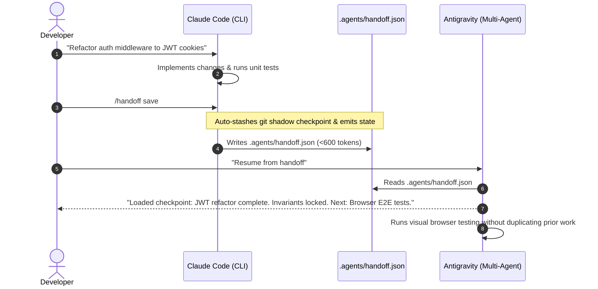

<div align="center">

# 🪢 H A N D O F F

### The universal state sync & safety rollback protocol for AI coding agents.
**Never re-explain your codebase to Claude Code, Antigravity, Cursor, or Codex again.**

[](#)
[](./LICENSE)
[](#-supported-agents)
[](#)

```
  ┌──────────────┐         /handoff save         ┌─────────────────────┐
  │  Claude Code │ ────────────────────────────▶ │                     │
  │  (Terminal)  │                               │    .agents/state    │
  └──────────────┘                               │   (Compact Schema   │
                                                 │   + Flight Record)  │
  ┌──────────────┐         /handoff resume       │                     │
  │ Antigravity  │ ◀──────────────────────────── │                     │
  │   (Swarm)    │                               └─────────────────────┘
```

</div>

---

## ⚡ The Problem: "Agent Amnesia"

When building real apps with modern AI coding tools, nobody stays in a single window:
1. You run **Claude Code** in your terminal for multi-file refactoring and running test suites.
2. You switch to **Antigravity** to dispatch multi-agent swarms, browse live rendered web apps, and inspect visual UI state.
3. You jump into **Cursor** or **Codex** to make quick inline edits and verify syntax diffs.

**The catch?** Each agent operates completely blind to the others:
- You waste minutes re-prompting and copy-pasting what you just accomplished.
- One agent unintentionally reverts delicate architectural decisions made by the previous one.
- An autonomous agent hallucinates, runs unconstrained mutations across 15 files, and leaves your git workspace broken.

---

## ✨ Why Handoff?

`handoff` is an open, human-designed protocol that establishes a continuous flight recorder and atomic safety airbag across your entire toolchain.

- 🧠 **Zero-Loss Context Handoff**: Serializes active tasks, critical architectural invariants, and touched files into an ultra-compressed (`< 600 token`) `.agents/handoff.json` ledger.
- 🛑 **Airbag Rollback Engine**: Automatically forks an atomic shadow branch (`handoff/checkpoint-<timestamp>`) before file changes take place. If an agent goes off the rails, `/handoff rollback` restores your exact pre-run tree in 200ms.
- 🔄 **Universal Interoperability**: Compatible out of the box with **Antigravity**, **Claude Code**, **Cursor**, **Codex**, **OpenHands**, and **Roo Code**.
- 💎 **Zero AI Slop**: No bloated 50KB instruction files. Just clean, deterministic shell scripts and a battle-tested `SKILL.md` specification.

---

## 🚀 Quick Install

### One-line universal install:
```bash
curl -sL https://raw.githubusercontent.com/birulyy2121/handoff/main/install.sh | bash
```

### Manual Installation by Agent:

| Agent | Destination Path |
| :--- | :--- |
| **Google Antigravity** | `~/.gemini/antigravity/skills/handoff/SKILL.md` (or workspace `.agents/skills/handoff/SKILL.md`) |
| **Claude Code** | `~/.claude/skills/handoff/SKILL.md` |
| **Cursor / Codex** | `.agents/skills/handoff/SKILL.md` (in project root) |

---

## 🛠️ How It Works



---

## ⌨️ Command Interface

Simply prompt your agent with these commands:

| Command | Action |
| :--- | :--- |
| `/handoff save [note]` | Captures active session goals, locks invariants, and writes `.agents/handoff.json` with a git shadow checkpoint. |
| `/handoff resume` | Reads the ledger, verifies repo state, and gives the next agent instant context in under 1 second. |
| `/handoff rollback` | Instantly rolls back dirty working tree changes to the last verified safe checkpoint. |
| `/handoff status` | Displays the current agent lineage, checkpoint hash, locked invariants, and pending tasks. |

---

## 📋 The State Ledger (`.agents/handoff.json`)

Here is what the ultra-lightweight state ledger looks like:

```json
{
  "$schema": "https://raw.githubusercontent.com/birulyy2121/handoff/main/schemas/handoff.schema.json",
  "version": "1.0.0",
  "timestamp": "2026-11-20T15:20:00Z",
  "origin_agent": "claude-code",
  "checkpoint_ref": "handoff/checkpoint-1795187000",
  "active_goal": "Migrate database connection pooling from mysql2 to pgvector",
  "invariants": [
    "Connection timeout must remain at 5000ms",
    "Never import native pg directly in frontend bundles"
  ],
  "touched_files": [
    "src/db/client.ts",
    "src/middleware/auth.ts"
  ],
  "next_steps": [
    "Run integration test suite: npm run test:db",
    "Verify connection pooling under 100 concurrent requests"
  ]
}
```

---

## 🎯 Who Is This For?

| Background | Why You'll Love Handoff |
| :--- | :--- |
| **Vibe Coders & Solo Founders** | You build entire products with natural language. `Handoff` acts as your personal flight recorder and panic button—never worry about an agent breaking your project again. |
| **Polyglot & Full-Stack Engineers** | You use the best agent for each job: Claude Code for terminal scripts, Antigravity for multi-agent workflows, Cursor for fast typing. `Handoff` bridges them seamlessly. |
| **Multi-Agent Orchestrators** | Building subagent swarms? `Handoff` gives you deterministic checkpointing and file coordination without token bloat. |

---

## 📁 Repository Structure

```text
handoff/
├── schemas/
│   └── handoff.schema.json # JSON schema specification
├── scripts/
│   ├── checkpoint.sh       # POSIX shadow-branch generator
│   └── checkpoint.ps1      # Windows PowerShell shadow-branch generator
├── SKILL.md                # The unified agent skill specification
├── install.sh              # One-line universal installer
├── README.md               # Repository documentation
└── LICENSE                 # MIT License
```

---

## 👥 Authors & Core Contributors

Built with precision by:

- **[birulyy2121](https://github.com/birulyy2121)** — Creator & Architecture Lead
- **[Google Antigravity](https://github.com/google-deepmind)** — Autonomous Systems & Multi-Agent Protocol Integration
- **[Arsh118198Imad](https://github.com/Arsh118198Imad)** — Core Engine & Agent Runtime Mechanics
- **[arhamshahbaz3499-ux](https://github.com/arhamshahbaz3499-ux)** — UX Lead, Terminal Interface & Design System
- **[shahzebejazsyed-gif](https://github.com/shahzebejazsyed-gif)** — Visual Assets & Media Architecture

---

<div align="center">
  <b>Star ⭐️ this repository to support open, reliable agent interoperability!</b>
</div>
